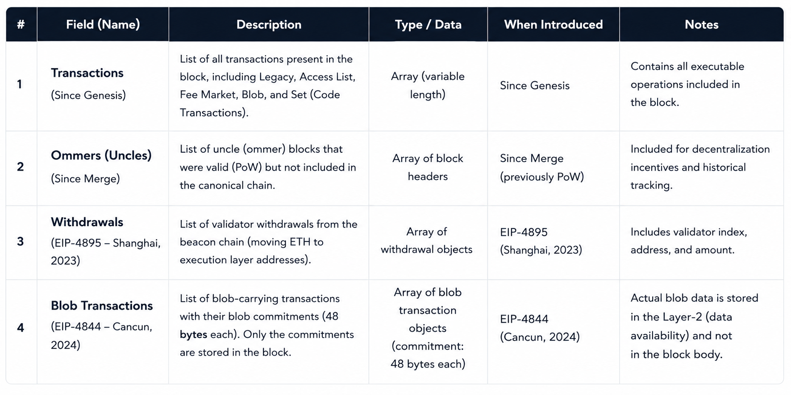
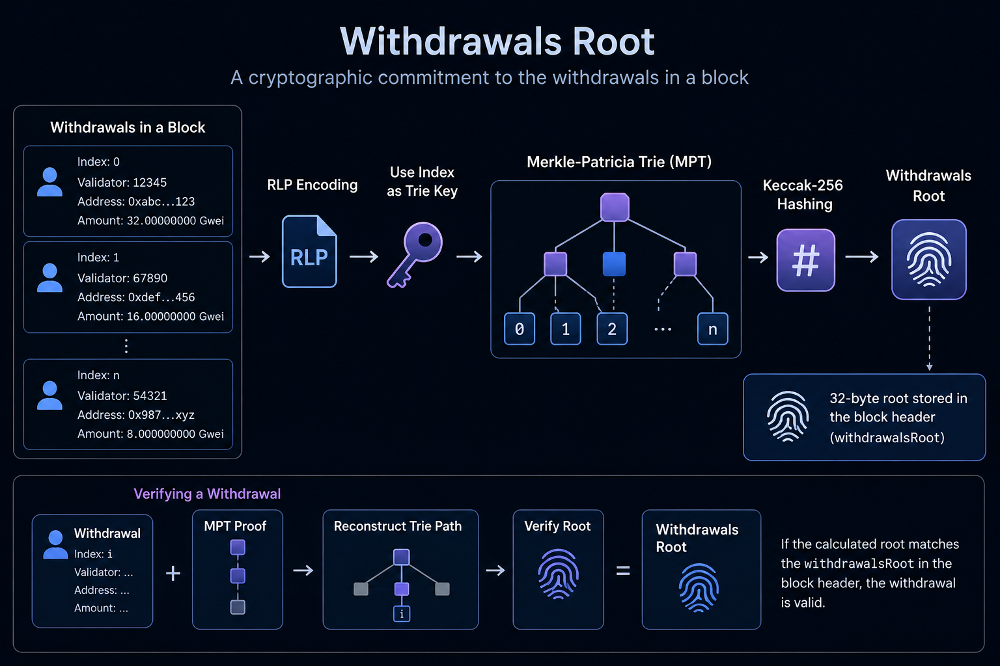

# Understanding Withdrawals in the Ethereum Block Body

Ethereum withdrawals are protocol-level balance updates that move ETH from validator balances tracked by the **Consensus Layer** to recipient addresses on the **Execution Layer**. They became part of Ethereum's execution payload with the Shanghai/Capella upgrade in April 2023 through [EIP-4895](https://eips.ethereum.org/EIPS/eip-4895).

Withdrawals are particularly important because they connect staking operations on the Beacon Chain with ordinary ETH balances visible to wallets, applications, and execution clients.

> **Key idea:** a withdrawal is not a user-signed transaction. It is a consensus-authorized operation included in the execution block body and applied after the block's regular transactions.

## 1. Why Were Withdrawals Added?

After Ethereum switched from Proof of Work to Proof of Stake in The Merge, validators could stake ETH to participate in consensus. But the Merge itself did not immediately enable validators to withdraw their funds to execution-layer addresses.

The Shanghai/Capella upgrade introduced withdrawals. This gave the protocol a standardized way to transfer eligible validator balances from the Consensus Layer to an execution-layer address.

The design is **push-based**: when a withdrawal is eligible and selected by the consensus protocol, it is included in a block and processed by the Execution Layer. The recipient does not need to submit a transaction, pay gas, or call a contract to claim that particular withdrawal.

## 2. Where Do Withdrawals Appear in a Block?

An Ethereum execution block body contains an ordered list of transactions and, since Shanghai, a withdrawals list. In the historical Proof-of-Work format, the body also had an ommers list; after The Merge, that list must be empty.

~~~text
Ethereum Execution Block
├── Header
│   ├── transactionsRoot
│   ├── receiptsRoot
│   ├── stateRoot
│   └── withdrawalsRoot
└── Body
    ├── Transactions
    ├── Ommers = []       (post-Merge)
    └── Withdrawals       (since Shanghai)
~~~

The diagram is conceptual. The header stores commitments to the different parts of block data, while the body contains the actual transaction and withdrawal lists.

The withdrawals list is separate from the transaction list. A withdrawal is not inserted into the transaction list, does not have a user transaction signature, and does not use an account transaction nonce.

## 3. What Does a Withdrawal Contain?

Each withdrawal object contains four fields:

| Field | Meaning |
|---|---|
| **index** | A global, monotonically increasing withdrawal index, starting at zero |
| **validatorIndex** | The index of the validator on the Consensus Layer |
| **address** | The 20-byte recipient address on the Execution Layer |
| **amount** | The amount of ETH to credit, expressed in Gwei |

The withdrawal index is a global sequence across withdrawals; it is not the same as the validator index. A validator may be associated with more than one withdrawal over time, while each withdrawal gets its own unique position in the global sequence.

A simplified object looks like this:

~~~json
{
  "index": "withdrawal sequence number",
  "validatorIndex": "consensus-layer validator number",
  "address": "execution-layer recipient address",
  "amount": "amount in Gwei"
}
~~~

This is a conceptual illustration, not a literal JSON-RPC response. Actual RPC responses encode numeric values using Ethereum's quantity conventions.

## 4. Why Is the Amount Measured in Gwei?

The amount field uses Gwei, where:

- 1 ETH = 1,000,000,000 Gwei
- 1 Gwei = 1,000,000,000 wei

For example, a withdrawal amount of 1,500,000,000 Gwei represents 1.5 ETH.

Execution clients must convert the amount to wei when updating an account balance in the execution state:

~~~text
withdrawal amount in Gwei
        |
        v
multiply by 1,000,000,000
        |
        v
amount in wei
        |
        v
increase recipient account balance
~~~

This unit conversion matters when interpreting block data, writing indexers, or comparing a withdrawal amount with an account balance obtained through JSON-RPC.

## 5. How Is a Withdrawal Processed?

The Consensus Layer determines which withdrawals are eligible and supplies the corresponding withdrawal data in the execution payload. The Execution Layer validates the payload and applies each withdrawal to the recipient's balance.

~~~mermaid
flowchart TD
    A["Validator balance and withdrawal credentials"] --> B["Consensus Layer determines eligible withdrawals"]
    B --> C["Withdrawal records added to execution payload"]
    C --> D["Execution client validates payload and withdrawals root"]
    D --> E["Execute regular transactions in block order"]
    E --> F["Apply withdrawals after transactions"]
    F --> G["Credit recipient balances"]
    G --> H["Resulting state is committed by stateRoot"]
~~~

For each listed withdrawal, the Execution Layer increases the balance of the specified address by the withdrawal amount. Under EIP-4895, this is an unconditional balance increase: it does not run a normal EVM transaction or require the recipient to execute contract code.

Withdrawals are processed **after regular user transactions** in the block's state transition. This ordering is part of the protocol rules.

### Withdrawals do not consume transaction gas

A withdrawal has no ordinary transaction gas cost. It is not competing with user transactions for the execution-gas allowance in the same way as a regular transaction. The protocol also bounds the number of withdrawals in a block so that processing them remains predictable.

As of the Ethereum mainnet rules following Pectra, a payload can contain at most **16 withdrawals**. The consensus protocol scans validator indices to find eligible withdrawals, subject to its own sweep limits and rules. This is a protocol parameter, not a guarantee that every block contains 16 withdrawals.

## 6. Partial Withdrawals and Full Withdrawals

Withdrawals are generally described as **partial** or **full** withdrawals. The distinction depends on the validator's status, balance, and withdrawal credentials.

### Partial withdrawals

A partial withdrawal transfers eligible excess balance to the validator's execution-layer withdrawal address while the validator remains active. It does not, by itself, mean that the validator has exited staking.

For validators using standard execution withdrawal credentials (credential type 0x01), rewards above the protocol's 32 ETH effective-balance target can be withdrawn automatically when eligible.

Pectra introduced compounding withdrawal credentials (type 0x02), enabling validators to compound rewards and support an effective balance up to 2,048 ETH under the applicable rules. Those validators do not follow the same simple automatic partial-withdrawal threshold as standard 0x01 validators.

### Full withdrawals

A full withdrawal returns the validator's remaining withdrawable balance after the validator has exited and the protocol's withdrawability conditions are met. A validator generally cannot turn an active validator's entire stake into a full withdrawal merely by requesting a normal execution-layer transaction.

In both cases, the Consensus Layer determines eligibility and the recipient address comes from the validator's withdrawal credentials.

## 7. What Are Withdrawal Credentials?

Withdrawal credentials are part of a validator's Consensus Layer data. They determine how the validator's funds can be withdrawn and, for execution-address credential types, identify the destination address for withdrawal payments.

The credential prefix is important:

- **0x00:** the original BLS withdrawal credential type, which does not directly encode an execution-layer withdrawal address.
- **0x01:** standard execution withdrawal credentials, which direct withdrawals to an execution address and support automatic partial withdrawals under the applicable rules.
- **0x02:** compounding execution withdrawal credentials, introduced with Pectra, which allow eligible rewards to remain compounded up to the protocol's higher effective-balance limit.

The transition from BLS withdrawal credentials to execution-address credentials requires a protocol-defined credential-change process. Users should take care when setting withdrawal credentials: an incorrect or inaccessible destination address can put funds at risk, and changing credentials is not an ordinary wallet setting that can always be freely edited later.

For current validator operations, use the official [Ethereum Staking Launchpad withdrawals guide](https://launchpad.ethereum.org/withdrawals) and the relevant consensus specifications.

## 8. What Is withdrawalsRoot?

The execution block header contains a field called **withdrawalsRoot**. It is a cryptographic commitment to the withdrawal list included in that execution block.

In the original Execution Layer design specified by EIP-4895, the withdrawals root is computed using a **Merkle Patricia Trie (MPT)**, similar in broad structure to transactionsRoot. Each withdrawal is encoded according to the execution-layer rules and inserted into the trie using its list index as the key.

~~~text
Ordered withdrawals list
        |
        v
Encode withdrawal objects
        |
        v
Index each item by list position
        |
        v
Build Merkle Patricia Trie
        |
        v
withdrawalsRoot in the execution block header
~~~

The root commits to both the withdrawal data and its ordering. Changing, inserting, removing, or reordering an item changes the commitment in the normal case.

This root is distinct from stateRoot:

- **withdrawalsRoot** commits to the withdrawal list included in the block.
- **stateRoot** commits to the resulting execution state after the block has been processed, including the resulting balance changes.

The Consensus Layer also uses SSZ data structures and SSZ roots for its own representations of execution payloads. Those consensus-layer commitments must not be casually confused with the MPT-based withdrawalsRoot in the execution block header. EIP-6465 proposes a change to the withdrawals-root representation; software should follow the specification and fork rules applicable to the block it is processing rather than assuming every field with a similar name uses the same encoding.

## 9. Withdrawals Are Not Transactions

Withdrawals and transactions both affect account balances, but they are fundamentally different protocol objects.

| Property | Regular transaction | Validator withdrawal |
|---|---|---|
| Initiated by | A signed transaction from a sender | Consensus protocol |
| Signature | Transaction signature required | No user transaction signature |
| Account nonce | Uses sender transaction nonce | Does not use an account transaction nonce |
| Gas | Subject to transaction gas rules | No ordinary transaction gas charge |
| Processing | Executed as a state transition in transaction order | Applied after the block's transactions |
| Main purpose | User or application operation | Transfer eligible validator balance to an execution address |

For example, sending ETH from one wallet to another is normally a transaction signed by the sender. A validator withdrawal is produced by the protocol and included as a withdrawal record.

A withdrawal also does not mean that the recipient address has called a contract. It represents a protocol-level balance credit.

## 10. How Withdrawals Relate to transactionsRoot, receiptsRoot, and stateRoot

An Ethereum block contains different commitments because the transaction list, withdrawal list, transaction receipts, and resulting state describe different things.

~~~text
Transactions in block body
        |
        +----> transactionsRoot

Withdrawals in block body
        |
        +----> withdrawalsRoot

Execution results for transactions
        |
        +----> receiptsRoot

Final execution state after transactions and withdrawals
        |
        +----> stateRoot
~~~

The roots cannot replace one another. The transactions root does not commit to the withdrawals list, and the withdrawals root does not prove the final account balances. The state root commits to the final state after block processing, including balance changes caused by withdrawals.

This separation enables a verifier to check different claims against the appropriate cryptographic commitment.

## 11. How Can Developers Inspect Withdrawals?

Developers can inspect the withdrawal list by querying an execution client for a block using JSON-RPC, for example with **eth_getBlockByNumber** or **eth_getBlockByHash**. For blocks after Shanghai, the response may include a withdrawals array and withdrawalsRoot. Blocks before withdrawals were enabled do not have the same post-Shanghai body structure.

Each withdrawal's index, validator index, address, and amount can be used by an indexer to track withdrawals and attribute them to validators and recipient accounts. Remember to interpret amount in Gwei rather than directly treating it as ETH.

Useful implementation checks include:

- Parse the fields according to the execution API schema.
- Apply the correct unit conversion from Gwei to wei.
- Do not treat withdrawals as user transactions or expect a transaction hash and receipt for each withdrawal.
- Verify the withdrawals list against the header's withdrawalsRoot using the rules that apply to that fork.
- Distinguish the block's committed withdrawals from the resulting account balance, which is part of the state.

The official [Ethereum Execution APIs](https://github.com/ethereum/execution-apis) document the JSON-RPC shapes, while [EIP-4895](https://eips.ethereum.org/EIPS/eip-4895) specifies the original execution-layer withdrawal operation.

## 12. Key Takeaways

- Withdrawals were introduced by EIP-4895 with the Shanghai/Capella upgrade.
- They transfer eligible validator balances from the Consensus Layer to execution-layer addresses.
- Each withdrawal has a global index, validator index, recipient address, and amount in Gwei.
- Withdrawals are protocol-level balance credits, not user-signed transactions, and do not consume ordinary transaction gas.
- The execution layer applies withdrawals after regular transactions.
- Partial and full withdrawals follow different eligibility conditions; Pectra's type 0x02 compounding credentials differ from standard type 0x01 withdrawal credentials.
- The execution block header's withdrawalsRoot commits to the withdrawal list, while stateRoot commits to the resulting state.

## References

- [EIP-4895: Beacon chain push withdrawals as operations](https://eips.ethereum.org/EIPS/eip-4895) — withdrawal object, execution payload field, withdrawals root, and state-transition rules.
- [Ethereum Staking Launchpad: Withdrawals](https://launchpad.ethereum.org/withdrawals) — validator withdrawal credentials, partial/full withdrawals, compounding credentials, and current operational limits.
- [Ethereum.org: How do Ethereum withdrawals work?](https://ethereum.org/videos/ethereum-staking-withdrawals/) — overview of the withdrawal sweep and withdrawal fields.
- [EIP-6465: SSZ withdrawals root](https://eips.ethereum.org/EIPS/eip-6465) — proposal concerning the SSZ withdrawals-root representation.
- [Ethereum Execution APIs](https://github.com/ethereum/execution-apis) — JSON-RPC schemas for block and withdrawal data.
- [Ethereum execution specifications](https://github.com/ethereum/execution-specs) — execution-layer processing rules.

*Last reviewed: October 12, 2026.*
