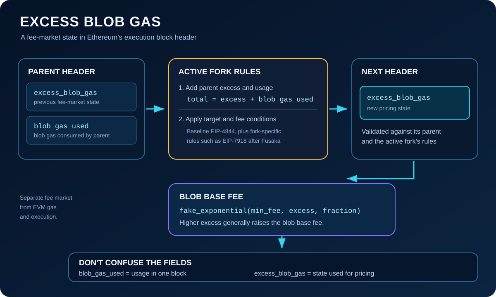

# Understanding `excessBlobGas` in the Ethereum Block Header

## Introduction

Ethereum's execution block header records protocol-critical information about a block. Since **EIP-4844 (Proto-Danksharding)**, it has also included two fields for Ethereum's separate blob-data fee market:

- `blobGasUsed` — the total blob gas consumed by blobs included in that block.
- `excessBlobGas` — a running value used to calculate the blob base fee.

These fields are related, but they do different jobs. `blobGasUsed` measures consumption in one block. `excessBlobGas` carries forward information about blob demand relative to the protocol's target and helps set the price of blob space.

> **Key idea:** `excessBlobGas` is not a byte count, a blob count, or a fee by itself. It is a block-header value used by Ethereum's blob-fee mechanism.

## 1. Where Is `excessBlobGas` Stored?

EIP-4844 extended the execution block header with two 64-bit unsigned integer fields: `blob_gas_used` and `excess_blob_gas`. They are encoded as part of the execution header—not in the block body and not inside the blob data itself.

A simplified view of the relevant part of the header is:

~~~text
Execution Block Header
├── ... existing header fields ...
├── base_fee_per_gas
├── withdrawals_root
├── blob_gas_used       // usage in this block
└── excess_blob_gas     // state used for blob pricing
~~~

This is a partial view rather than a complete header definition. Ethereum's header fields evolve through network upgrades, so use the specification for the fork being implemented when validating the full encoding.

The protocol specification uses snake case (`excess_blob_gas`). The JSON-RPC representation commonly uses camel case (`excessBlobGas`).

## 2. Why Does Ethereum Need It?

Layer 2 rollups publish transaction data to Ethereum so that users and other participants can verify or reconstruct rollup state. EIP-4844 introduced blobs as a data-availability mechanism with a fee market separate from ordinary EVM execution gas.

A fee market needs a way to respond to demand over time. If Ethereum priced blobs based only on blob usage in one isolated block, the price signal would not preserve accumulated demand relative to the target. `excessBlobGas` provides that running state.

~~~mermaid
flowchart TD
    A["Parent header: excessBlobGas + blobGasUsed"] --> B["Apply target and active fork rules"]
    B --> C["Calculate excessBlobGas for the next header"]
    C --> D["Calculate blob base fee"]
    D --> E["Blob transactions pay for blob gas"]
    E --> F["Demand above target can raise excess and price"]
~~~

This does not mean the field is itself the price. Ethereum calculates the blob base fee from the `excessBlobGas` value and the active protocol parameters.

## 3. The Original EIP-4844 Calculation

In the baseline EIP-4844 rule, the next block's excess is derived from the **parent header**:

~~~python
def calc_excess_blob_gas(parent, target_blob_gas):
    total = parent.excess_blob_gas + parent.blob_gas_used

    if total < target_blob_gas:
        return 0

    return total - target_blob_gas
~~~

In compact form:

~~~text
next_excess_blob_gas =
    max(
        0,
        parent.excess_blob_gas
        + parent.blob_gas_used
        - target_blob_gas
    )
~~~

Here, `target_blob_gas` is the target blob gas for the active protocol configuration. It is not a permanent constant that developers should hard-code for every Ethereum fork.

This distinction between parent and child is important:

- To validate a new block's `excessBlobGas`, clients derive the expected value from the parent header and the active rules.
- To calculate the blob base fee for a block, the fee function uses that block's `excessBlobGas` and the applicable fee parameters.

## 4. A Worked Example

The original Cancun configuration targeted three blobs per block. One blob represents \(2^{17}\), or **131,072 blob gas**, so the original target was:

~~~text
3 × 131,072 = 393,216 blob gas
~~~

The example below demonstrates the **baseline EIP-4844 path**, before considering the later EIP-7918 reserve-price condition.

Assume:

~~~text
parent.excess_blob_gas = 100,000
parent.blob_gas_used   = 500,000
target_blob_gas        = 393,216
~~~

First, add the parent's accumulated excess and its blob usage:

~~~text
100,000 + 500,000 = 600,000
~~~

Then subtract the target:

~~~text
600,000 - 393,216 = 206,784
~~~

Therefore, under the baseline rule:

~~~text
next excess_blob_gas = 206,784
~~~

If the sum of the parent's excess and usage is below the target, the result is zero instead. That lower bound prevents the value from becoming negative.

**Important:** the three-blob target is historical. The target and maximum blob count have changed since Cancun, and implementations must read the configuration for the fork and chain they support.

## 5. From `excessBlobGas` to the Blob Base Fee

EIP-4844 defines the blob base fee using an integer approximation of an exponential function:

~~~python
base_fee_per_blob_gas = fake_exponential(
    MIN_BASE_FEE_PER_BLOB_GAS,
    header.excess_blob_gas,
    BLOB_BASE_FEE_UPDATE_FRACTION,
)
~~~

The active fork configuration determines the applicable fee-update fraction. At a high level:

~~~text
higher excessBlobGas
        ↓
higher blob base fee
        ↓
higher cost per unit of blob gas
~~~

A blob transaction includes `max_fee_per_blob_gas`, which specifies the maximum blob-gas price the sender is willing to pay. Conceptually, the blob fee is:

~~~text
blob fee = total blob gas in transaction × blob base fee
~~~

The blob fee is separate from the ordinary execution fee. It is charged and burned under EIP-4844, and it is not refunded simply because EVM execution later fails.

## 6. What Changed After EIP-4844?

The original formula is an excellent starting point, but it is not the complete description of the current mainnet rules. Two later developments matter.

### EIP-7840: parameters vary by fork

EIP-7840 adds a `blobSchedule` to execution-client configuration. This lets different forks specify their blob target, maximum, and `baseFeeUpdateFraction`.

For context, the mainnet schedule progressed from:

| Configuration | Target blobs | Maximum blobs |
|---|---:|---:|
| Cancun (Dencun) | 3 | 6 |
| Prague (Pectra) | 6 | 9 |
| Fusaka BPO1 | 10 | 15 |
| Fusaka BPO2 | 14 | 21 |

BPO2's parameters became active on mainnet on **January 7, 2026**. That is the active mainnet target/maximum documented at the time of this article's review, but clients should always use the actual active configuration instead of treating a table in an educational article as a protocol constant.

With 131,072 blob gas per blob, the BPO2 target of 14 blobs corresponds to 1,835,008 blob gas, and its maximum of 21 blobs corresponds to 2,752,512 blob gas.

### EIP-7918: a reserve-price condition

EIP-7918, included in Fusaka, changes the excess update behavior when the blob base fee falls below a reserve price tied to execution cost. In that case, the baseline rule's normal subtraction of the target is replaced by an alternative calculation, designed to prevent the blob market from driving its price signal too low when execution costs dominate.

Conceptually, after calculating the parent's excess plus usage and checking the target, the active rule chooses between two paths:

~~~mermaid
flowchart TD
    A["Parent excess + parent blob usage"] --> B{"Total below target?"}
    B -->|Yes| C["Next excess = 0"]
    B -->|No| D{"Blob base fee below reserve price?"}
    D -->|Yes| E["Apply EIP-7918 alternative update"]
    D -->|No| F["Baseline update: total − target"]
~~~

The EIP-7918 alternative is defined using the active blob schedule. In simplified notation:

~~~python
target = GAS_PER_BLOB * blob_schedule.target
total = parent.excess_blob_gas + parent.blob_gas_used

if total < target:
    next_excess = 0
elif blob_base_fee(parent) < reserve_price(parent):
    next_excess = (
        parent.excess_blob_gas
        + parent.blob_gas_used
          * (blob_schedule.max - blob_schedule.target)
          // blob_schedule.max
    )
else:
    next_excess = total - target
~~~

This pseudocode explains the branching behavior; production clients must implement the exact comparison, integer arithmetic, fee calculation, and fork conditions specified by EIP-7918 and the active configuration. In particular, do not replace the full specification with the simplified `max(0, total - target)` expression in a modern consensus client.

## 7. What `excessBlobGas` Is—and Is Not

**It is not the number of blobs.** Each blob consumes a fixed amount of blob gas, but `excessBlobGas` can grow across many blocks and is not constrained to one block's maximum usage.

**It is not `blobGasUsed`.** `blobGasUsed` measures usage in the current block. `excessBlobGas` represents the pricing state derived from prior demand and the applicable protocol rules.

**It is not the blob base fee.** The fee is calculated from the excess value and the active fee-update parameters.

**It is not regular EVM gas.** Blob gas prices the blob-data resource separately from computation and execution.

**It does not contain blob data.** The field is in the execution header. The blob payload is handled through the blob sidecar and data-availability mechanisms.

## 8. Why Developers Should Understand It

Understanding `excessBlobGas` helps when you:

- inspect execution headers in an Ethereum block explorer or RPC response;
- debug blob transactions and blob-fee estimates;
- build analytics for rollup posting costs;
- implement block validation in an execution client;
- compare Ethereum protocol behavior before and after a fork.

When debugging, inspect the parent header's `excessBlobGas` and `blobGasUsed`, the current block's fee-related values, and the active `blobSchedule`. Under post-Fusaka rules, also account for EIP-7918's reserve-price condition. Looking at only one field can lead to the wrong conclusion about why a fee changed.

## Conclusion

`excessBlobGas` is a 64-bit execution block-header field introduced by EIP-4844 to preserve blob-demand information for Ethereum's blob fee market. In the original rule, the next value is derived by adding the parent header's excess and usage, then subtracting the active target with a lower bound of zero.

Later upgrades made the implementation fork-dependent. EIP-7840 configures the target, maximum, and fee-update fraction per fork. EIP-7918, included in Fusaka, adds a reserve-price branch that changes the update when the blob base fee is too low relative to execution cost.

The mental model to remember is:

~~~text
parent.excessBlobGas + parent.blobGasUsed
                    ↓
     active fork's excess-update rule
                    ↓
         next block's excessBlobGas
                    ↓
           blob base-fee function
                    ↓
        cost of publishing rollup data
~~~

Learn the baseline EIP-4844 formula first—but when implementing or analyzing Ethereum today, follow the active fork specification and configuration.

## References

- [EIP-4844: Shard Blob Transactions](https://eips.ethereum.org/EIPS/eip-4844)
- [EIP-7840: Add blob schedule to EL config files](https://eips.ethereum.org/EIPS/eip-7840)
- [EIP-7918: Blob base fee bounded by execution cost](https://eips.ethereum.org/EIPS/eip-7918)
- [EIP-8135: Hardfork Meta - BPO2](https://eips.ethereum.org/EIPS/eip-8135)
- [Ethereum Foundation: Fusaka Mainnet Announcement](https://blog.ethereum.org/2025/11/06/fusaka-mainnet-announcement)
- [Ethereum Foundation: Protocol Priorities Update for 2026](https://blog.ethereum.org/2026/02/18/protocol-priorities-update-2026)

*Last reviewed: October 12, 2026.*
