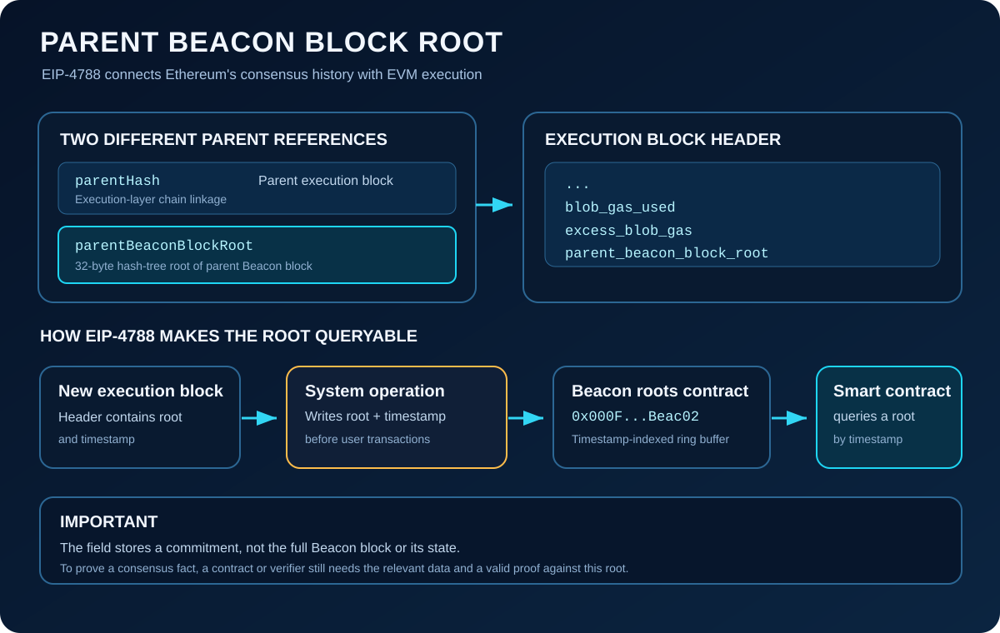

# Understanding \`parentBeaconBlockRoot\` in the Ethereum Block Header

## Introduction

Ethereum is made of two closely connected protocol layers:

- The **Consensus Layer** coordinates validators and the Beacon Chain.
- The **Execution Layer** processes transactions, runs the EVM, and updates account and contract state.

For much of Ethereum's history, an ordinary smart contract could not directly access a cryptographic commitment to Beacon Chain history. **EIP-4788**, activated with the Dencun upgrade in March 2024, added a field called \`parentBeaconBlockRoot\` and a system contract that makes recent Beacon block roots available to EVM applications.

This creates a useful bridge between consensus-layer information and execution-layer smart contracts.

> **Key idea:** \`parentBeaconBlockRoot\` is a 32-byte root of a parent Beacon block. It is different from \`parentHash\`, which links an execution block to its parent execution block.

## 1. What Is \`parentBeaconBlockRoot\`?

\`parentBeaconBlockRoot\` is a field in the Ethereum execution block header. It was introduced by **EIP-4788: Beacon block root in the EVM**.

The value is the hash-tree-root of the **parent Beacon block** corresponding to the Beacon block that contains the execution payload. A root is a compact cryptographic commitment to the structure and contents of that Beacon block; it is not the complete block or its state.

At a high level, the field allows an execution block to carry a reference to Ethereum's consensus-layer history:

\`\`\`text
Beacon Chain
     |
     | Beacon block root of the parent
     v
parentBeaconBlockRoot
     |
     v
Execution block header
\`\`\`

The value has a fixed length of **32 bytes**.

## 2. Where Does It Appear in the Block Header?

EIP-4788 added \`parent_beacon_block_root\` to the execution block header. In a simplified view of the later header fields:

\`\`\`text
Execution Block Header
├── ... existing header fields ...
├── base_fee_per_gas
├── withdrawals_root
├── blob_gas_used
├── excess_blob_gas
└── parent_beacon_block_root
\`\`\`

This is a partial diagram, not the complete header encoding. Header definitions can evolve as Ethereum upgrades, so clients must follow the specifications for the fork they validate.

In execution-layer protocol specifications the field is written in snake case, \`parent_beacon_block_root\`. The JSON-RPC block representation commonly exposes it as \`parentBeaconBlockRoot\`.

## 3. \`parentBeaconBlockRoot\` vs \`parentHash\`

These names sound similar, but the fields connect different parts of Ethereum.

| Field | Points to | Layer |
|---|---|---|
| \`parentHash\` | The parent execution block's hash | Execution Layer |
| \`parentBeaconBlockRoot\` | The parent Beacon block's hash-tree-root | Consensus Layer |

The distinction matters because Ethereum maintains related but different block structures at the execution and consensus layers.

\`\`\`text
Execution chain                   Beacon Chain
---------------                   ------------
Execution block N                 Beacon block N
    |                                 |
    | parentHash                      | parent root
    v                                 v
Execution block N-1               Beacon block N-1

parentBeaconBlockRoot commits to the
parent Beacon block, not the parent
execution block.
\`\`\`

Neither field is a replacement for the other. They commit to different structures and serve different protocol purposes.

## 4. Why Did Ethereum Introduce It?

Smart contracts sometimes need information about the consensus layer. Examples include applications that depend on validator-related information, consensus-layer timing, or proofs of Beacon Chain state.

Before EIP-4788, making this kind of information available to contracts generally required an external party to supply it or a separate verification mechanism. That can introduce additional trust assumptions if the contract cannot independently verify the supplied data.

EIP-4788 provides a protocol-maintained source of recent Beacon block roots. An application can request a root by timestamp and use it as the starting commitment for a suitable proof.

The key design principle is:

\`\`\`text
Consensus Layer
      |
      | Beacon block root
      v
Execution block header
      |
      | EIP-4788 system operation
      v
Beacon roots contract
      |
      | Contract reads a root
      v
EVM application verifies relevant proof
\`\`\`

Importantly, the root does **not** automatically reveal all Beacon block data to a smart contract. The application still needs the relevant data and a proof that can be checked against the root.

## 5. The EIP-4788 Beacon Roots Contract

EIP-4788 specifies a contract deployed at a protocol-defined address:

\`\`\`text
0x000F3df6D732807Ef1319fB7B8bB8522d0Beac02
\`\`\`

The contract stores Beacon block roots indexed by execution block timestamps. Ethereum performs a protocol-level system operation before ordinary user transactions are processed, supplying the execution payload timestamp and its \`parentBeaconBlockRoot\`.

The contract maintains a **ring buffer**: a fixed-size collection of entries that are reused as newer timestamps arrive. The EIP specifies a history buffer length of **8,191 entries**.

Conceptually:

\`\`\`text
New execution block
    |
    | timestamp + parentBeaconBlockRoot
    v
EIP-4788 system operation
    |
    v
Beacon roots contract
    |
    +--> timestamp-indexed ring buffer
             |
             +--> stored timestamp
             +--> 32-byte Beacon root
\`\`\`

This design avoids an ever-growing storage structure while keeping a useful window of recent roots available to contracts.

### Why store the timestamp as well as the root?

A ring buffer reuses positions. When an entry is overwritten by a newer block, the old root must not be returned for the old timestamp by accident.

The contract therefore records the timestamp associated with an entry and checks it when retrieving a root. If the requested timestamp is not the one currently stored at that position—or the requested entry is unavailable—the lookup reverts instead of returning a mismatched root.

The 8,191-entry buffer represents roughly 27 hours if there is one execution payload per 12-second Beacon slot. This is an approximation of the history window, not a guarantee that every timestamp in every possible interval will have a root.

## 6. How Can a Smart Contract Read a Beacon Root?

The Beacon roots contract exposes a timestamp-based lookup. A simplified Solidity interface looks like this:

\`\`\`solidity
interface IBeaconRoots {
    function get(uint256 timestamp)
        external
        view
        returns (bytes32);
}
\`\`\`

An application can query the root associated with an available execution timestamp:

\`\`\`solidity
address constant BEACON_ROOTS =
    0x000F3df6D732807Ef1319fB7B8bB8522d0Beac02;

function getCurrentBlockParentBeaconRoot()
    external
    view
    returns (bytes32)
{
    return IBeaconRoots(BEACON_ROOTS).get(block.timestamp);
}
\`\`\`

This example demonstrates how the contract can be called; production code should include the full interface, error handling, tests, and assumptions appropriate to the application. A lookup only works when that timestamp is available in the buffer.

Notice what the function returns: **one 32-byte root**, not a decoded Beacon block or validator record.

## 7. What Can Developers Build With It?

A Beacon block root is a cryptographic commitment, so the most important use case is verification—not simply reading arbitrary consensus data.

Depending on the application and the proof scheme it implements, EIP-4788 can help support:

- **Trust-minimized consensus data access:** use a protocol-provided root as the anchor for verifying relevant Beacon data.
- **Validator and staking applications:** verify supported validator-related facts when the correct data and proof are available.
- **Restaking and interoperability designs:** build contracts that need to verify claims about Ethereum consensus-layer data.
- **On-chain verification systems:** use a recent root as an input to a proof-verification process.

These examples do not mean that every validator property is automatically exposed by the contract. An application must still understand the Beacon Chain's data structures and provide a proof matching the exact state field it wants to verify.

## 8. Important Limitations

### It stores roots, not the whole Beacon block

A 32-byte root is a cryptographic commitment. It is not a copy of every field, validator balance, or consensus-layer state value.

### A root alone does not prove a claim

To demonstrate that a particular fact belongs to the committed Beacon state, an application needs the relevant data and a valid proof—such as an appropriate Merkle proof—whose verification is anchored to that root.

### The history window is limited

The ring buffer is finite. Roots can be overwritten as new entries arrive, so contracts should not assume that the Beacon roots contract is a permanent archive.

### The timestamp must match an available entry

A contract must request the timestamp associated with the intended execution block. If the timestamp is absent or has already been overwritten, retrieval fails.

### It is not the same as a consensus light client

EIP-4788 exposes recent roots to the EVM. It does not, by itself, implement a general-purpose light client, provide every consensus proof, or eliminate the need to verify the specific claim an application relies on.

## 9. Why Developers Should Understand It

For a smart-contract developer, \`parentBeaconBlockRoot\` is a good example of how Ethereum's execution and consensus layers interact.

It is useful when you:

- inspect execution block headers through an Ethereum JSON-RPC endpoint;
- learn how protocol-level system operations affect execution state;
- study Beacon Chain data structures and SSZ Merkle proofs;
- design applications that need verifiable consensus-layer information;
- review Ethereum upgrades that change block-header fields or execution behavior.

It also highlights an important architectural lesson: exposing a cryptographic commitment is not the same as exposing all the committed data. The root gives a contract a verification anchor; the application must still know how to construct and verify the relevant proof.

## Conclusion

\`parentBeaconBlockRoot\` is a 32-byte execution block-header field introduced by EIP-4788. It commits to the parent Beacon block and provides a protocol-maintained link from execution-layer blocks to consensus-layer history.

EIP-4788 also adds a Beacon roots contract at \`0x000F3df6D732807Ef1319fB7B8bB8522d0Beac02\`. A protocol-level system operation stores a root together with its timestamp in a fixed-size ring buffer, allowing EVM contracts to retrieve recent roots by timestamp.

The mental model to remember is:

\`\`\`text
Parent Beacon block
        |
        v
parentBeaconBlockRoot
        |
        v
Execution block header
        |
        v
EIP-4788 Beacon roots contract
        |
        v
Root used to verify suitable consensus data
\`\`\`

**The field itself is a commitment—not the data or proof.** Its significance is that it gives smart contracts a protocol-defined starting point for verifying selected facts about Ethereum's consensus layer.

## References

- [EIP-4788: Beacon block root in the EVM](https://eips.ethereum.org/EIPS/eip-4788)
- [Ethereum execution specifications](https://github.com/ethereum/execution-specs)
- [Ethereum Consensus Specs](https://github.com/ethereum/consensus-specs)
- [Ethereum.org: The Beacon Chain](https://ethereum.org/en/roadmap/beacon-chain/)

*Last reviewed: October 12, 2026.*
