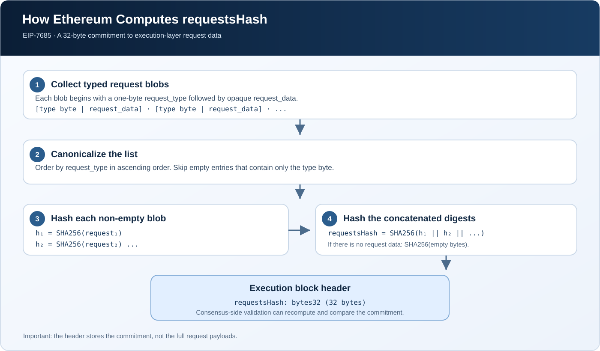

# Understanding `requestsHash` in the Ethereum Block Header

## Introduction

Ethereum's execution layer can generate requests that the consensus layer must process. Examples include validator deposits, execution-triggered withdrawals, and validator consolidations. Before EIP-7685, adding new kinds of execution-layer requests could require more bespoke protocol plumbing.

**EIP-7685: General Purpose Execution Layer Requests** introduces a common framework for these messages. Its block-header field, `requestsHash`, commits to the request data associated with a block. It lets the consensus layer check that the requests it receives match the requests committed to by the execution layer.

> **Key idea:** `requestsHash` is a 32-byte cryptographic commitment to execution-layer requests. It is not the requests themselves, and it is not a hash of the entire block body.

## 1. What Is `requestsHash`?

`requestsHash` is a field in the Ethereum execution block header introduced by **EIP-7685** and activated on Ethereum mainnet as part of the **Pectra upgrade in May 2025**.

Its essential properties are:

- **Size:** 32 bytes (`bytes32`).
- **Purpose:** commits to the block's collected execution-layer requests.
- **Hash function:** SHA-256, including a two-stage hashing process.
- **Specification name:** `requests_hash` in the EIP and execution specifications; `requestsHash` in the common JSON-RPC camel-case representation.

A simplified view of the later header fields is:

~~~text
Execution Block Header
├── ... existing header fields ...
├── blob_gas_used
├── excess_blob_gas
├── parent_beacon_block_root
└── requests_hash
~~~

This is a partial view, not the complete serialized header. Ethereum's header definition evolves through network upgrades, so implementations must follow the specification for the fork they support.

## 2. What Is an Execution-Layer Request?

EIP-7685 defines a request blob as a one-byte `request_type` followed by an opaque byte array called `request_data`:

~~~text
request = request_type || request_data
~~~

The type byte tells the protocol which request format is being used. The rest of the bytes are interpreted according to that request type. EIP-7685 deliberately does not require every kind of request to use one universal internal encoding.

Examples in the Pectra-era request framework include:

- **Deposit requests** — validator deposits derived from deposit-contract events (EIP-6110).
- **Withdrawal requests** — execution-triggered requests for validator withdrawals (EIP-7002).
- **Consolidation requests** — requests to consolidate validators (EIP-7251).

These examples are specific request types that use the common framework. The framework is designed so additional types can be introduced without adding a separate header field for each type.

An execution-layer request should not be confused with an ordinary user transaction. A transaction may trigger or provide data for a request, but the request is a protocol-defined output that the consensus layer can process under its own rules.

## 3. Why Does the Header Need a Hash of the Requests?

The execution and consensus layers have distinct responsibilities. The execution layer processes transactions and derives request data; the consensus layer applies the relevant consensus rules to those requests.

The header does not need to duplicate every request byte. Instead, `requestsHash` acts as a compact commitment:

~~~text
Execution Layer
      |
      | collect typed request data
      v
Compute requestsHash
      |
      v
Execution block header
      |
      | request data is made available to the consensus layer
      v
Consensus Layer
      |
      | recompute the commitment and compare
      v
Check that the request data matches the header commitment
~~~

If the request data used by the consensus layer does not produce the committed value, the mismatch can be detected during block validation. The hash does not, by itself, make a request valid or authorize an action; the relevant protocol rules still determine how each request is validated and processed.

## 4. How Is `requestsHash` Computed?

The value is computed using SHA-256 in two stages. The details matter: it is **not** simply `SHA256(all request bytes concatenated together)`, and it is not Keccak-256.

### Step 1 — Order request blobs by type

The request blobs must be arranged in ascending order of `request_type`. Ordering by type makes it possible for the layers to reconstruct the same canonical sequence.

EIP-7685 does not define ordering between individual request objects inside the opaque data for a particular type. That detail belongs to the specification for that request type.

### Step 2 — Ignore entries with no request data

A request entry that consists only of its one-byte type has no payload. Such entries are excluded from the hash computation. This rule makes the hash for a block with no request data stable, independent of which empty request types a fork defines.

### Step 3 — Hash each remaining request blob

For each non-empty request blob, compute its SHA-256 digest:

~~~text
h₁ = SHA256(request₁)
h₂ = SHA256(request₂)
...
~~~

Each digest is 32 bytes.

### Step 4 — Hash the concatenated digests

Concatenate those 32-byte digests in the required order, then compute SHA-256 over the resulting byte sequence:

~~~text
requestsHash = SHA256(h₁ || h₂ || ... || hₙ)
~~~

The result is the 32-byte value stored in the block header. If there is no request data, the intermediate sequence is empty and the result is `SHA256(empty bytes)`.

The EIP's pseudocode expresses the same process:

~~~python
def compute_requests_hash(block_requests):
    digest_stream = b""

    for request in block_requests:
        # A request is the type byte followed by its data.
        # Skip entries containing only the type byte.
        if len(request) > 1:
            digest_stream += sha256(request).digest()

    return sha256(digest_stream).digest()
~~~

This is illustrative pseudocode for the commitment algorithm; production clients should use their implementation language's byte types and SHA-256 library and follow the exact fork specification.

## 5. What Does the Hash Actually Guarantee?

`requestsHash` commits to the ordered, non-empty request blobs under the rules above. A participant that has the request data can recompute the commitment and compare it with the header field.

It is useful to keep these distinctions in mind:

- **Commitment, not payload:** the 32-byte field does not contain the full request data.
- **Integrity, not secrecy:** hashing does not encrypt requests or make their contents private.
- **Not a validity proof:** a matching hash does not mean every requested action is valid. The relevant execution- and consensus-layer rules still apply.
- **Not Keccak-256:** Ethereum uses Keccak-256 for several other protocol structures, but EIP-7685 specifies SHA-256 for this commitment.

## 6. How Is It Different From Other Header Roots?

Ethereum has several fields that look like hashes but commit to different data:

- `transactionsRoot` commits to the block's transaction trie.
- `receiptsRoot` commits to the transaction-receipt trie.
- `withdrawalsRoot` commits to the block's withdrawals structure.
- `parentBeaconBlockRoot` references the parent Beacon block's root.
- **`requestsHash` commits to the ordered request blobs defined by EIP-7685.**

These fields are not interchangeable. Each one binds a different piece of protocol data to the execution block header.

## 7. Why Should Smart-Contract and Ethereum Developers Care?

Even if you are not implementing a consensus client, `requestsHash` is worth understanding when reading block headers, exploring execution-client code, building indexers, or studying how Ethereum upgrades connect the execution and consensus layers.

For developers working on clients and protocol infrastructure, the critical implementation details are the request-type ordering, the exclusion of type-only empty entries, the two-stage SHA-256 calculation, and the active fork's request definitions. A mistake in any of these details can cause the computed commitment to disagree with the one in the header.

For ordinary smart-contract developers, the main takeaway is architectural: the EVM does not gain a direct `requestsHash` opcode or automatic access to arbitrary request data. The field is part of the block-header protocol, and request processing is coordinated across Ethereum's layers.

## Summary

`requestsHash` is the EIP-7685, 32-byte SHA-256 commitment to the execution-layer request blobs associated with a block. Request blobs are ordered by type; type-only empty entries are skipped; each remaining blob is hashed; and the concatenation of those digests is hashed again. This gives Ethereum a general-purpose way to commit to execution-triggered requests without adding a new header field for every request type.

## References

- [EIP-7685: General purpose execution layer requests](https://eips.ethereum.org/EIPS/eip-7685)
- [Ethereum Execution Specs — Prague request processing](https://ethereum.github.io/execution-specs/src/ethereum/forks/prague/requests.html)
- [EIP-6110: Supply validator deposits on chain](https://eips.ethereum.org/EIPS/eip-6110)
- [EIP-7002: Execution layer triggerable exits](https://eips.ethereum.org/EIPS/eip-7002)
- [EIP-7251: Increase the MAX_EFFECTIVE_BALANCE](https://eips.ethereum.org/EIPS/eip-7251)
